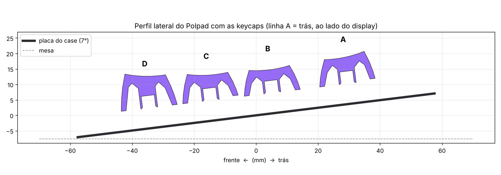
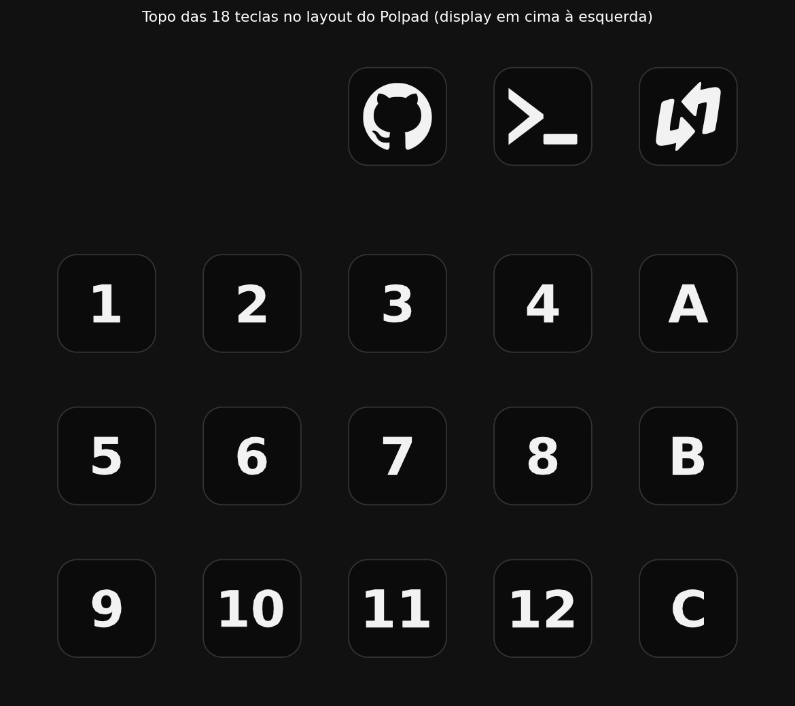

# Keycaps do Polpad

18 keycaps esculpidas com encaixe **Cherry MX** (serve em Gateron, Outemu,
Akko, Kailh BOX e outros clones MX), feitas para o case do Polpad.



## Perfil

O case já inclina 7° (bandeja mais alta atrás). As keycaps completam essa
inclinação com uma "concha" no estilo MDA/SA baixo: o topo de cada linha
tangencia um cilindro de raio 286 mm, com dish esférico de 1 mm.

| Linha | Posição | Qtd. | Altura | Topo vs. placa | Topo vs. mesa |
|---|---|---|---|---|---|
| A | trás, ao lado do display | 3 | 9,55 mm | +4,9° | +11,9° |
| B | 2ª | 5 | 8,50 mm | 0° | +7,0° |
| C | 3ª | 5 | 9,20 mm | −4,0° | +3,0° |
| D | frente | 5 | 11,31 mm | −8,0° | −1,0° |

(+ = mais alto atrás, virado para o usuário)

Cada keycap tem de 1 a 4 entalhes pequenos na borda de baixo, do lado de
**trás**: 1 = linha A ... 4 = linha D. Servem para não trocar as linhas e
para saber qual lado vai para trás.

## Encaixe MX

Referências: especificação Cherry da fenda da keycap (cruz de 4,1 +0,05 mm,
braços de 1,17 ±0,02 mm) e a biblioteca KeyV2. A folga soma ao nominal para
compensar o FDM, que imprime furos menores do que o desenho.

Com a folga padrão de **0,15 mm**:

- cruz de 4,25 mm de comprimento
- braço horizontal de 1,325 mm e braço vertical de 1,245 mm
- 4 mm de profundidade, com chanfro de 0,4 mm na entrada (contra o "pé de
  elefante")
- haste de Ø 5,5 mm, que cabe em switches BOX

## Arquivos

| Arquivo | O que é |
|---|---|
| `stl/teste_encaixe_folgas.stl` | **Imprima primeiro.** 5 hastes de teste: 1 bolinha = 0,05 mm, 2 = 0,10, 3 = 0,15, 4 = 0,20 e 5 = 0,25 mm |
| `stl/polpad_18_keycaps_mesa.stl` | As 18 keycaps já organizadas numa mesa só (≈ 110 × 90 mm) |
| `stl/keycap_linhaA_x3.stl` ... `linhaD_x5.stl` | Uma keycap de cada linha (o nome diz quantas imprimir) |
| `gerar_keycaps.py` | Gerador paramétrico |

## Impressão (Ender-3 V3 SE / Cura)

- Imprima **em pé**, com a borda aberta na mesa. Não precisa de suporte: o
  teto interno é chanfrado a 45° e a haste é ligada ao teto por um cone.
- Camada de 0,12 mm deixa o dish liso. Use paredes de 1,6 mm (4 filetes) e
  preenchimento de 20% ou mais.
- Sem brim. Se a cruz sair apertada, use *Initial Layer Horizontal
  Expansion* = −0,1 mm antes de aumentar a folga.

## Versão em duas cores: padrão topográfico



Um único "mapa de relevo" cobre o macropad inteiro, então as curvas de nível
continuam de uma tecla para a vizinha. As linhas brancas ficam **embutidas**
no topo com 0,8 mm de espessura (a superfície continua lisa ao toque) e têm
0,6 mm de largura, com espaço mínimo de 0,5 mm entre elas. Onde as curvas
ficariam apertadas demais, a linha é interrompida, como num penhasco de um
mapa real.

Cada keycap sai **inteira, numa peça só**. O fatiador só precisa saber qual
volume é de qual cor, por isso ela vem dividida em duas partes do mesmo
objeto, que são impressas fundidas, camada por camada.

| Arquivo | O que é |
|---|---|
| `stl_topo/polpad_18_keycaps.3mf` | **Recomendado.** 18 objetos, cada um com 2 partes: `base_preta` e `desenho_branco`. Basta atribuir o filamento de cada parte |
| `stl_topo/polpad_mesa_BASE.stl` | Alternativa: cor 1, preto (as 18 keycaps) |
| `stl_topo/polpad_mesa_LINHAS.stl` | Alternativa: cor 2, branco (só os desenhos) |

Os dois STLs estão nas mesmas coordenadas e precisam ser importados juntos:

- **Bambu Studio / OrcaSlicer / PrusaSlicer:** selecione os dois arquivos e
  arraste juntos. Quando perguntar *"carregar como um único objeto com várias
  partes?"*, responda **Sim**. Depois atribua o filamento de cada parte.
- **Cura (duas extrusoras):** abra os dois arquivos, selecione ambos, use
  *Mesclar modelos* (Ctrl+Alt+G) e atribua uma extrusora a cada um.

A cor muda numa faixa de z = 6,7 a 12 mm, cerca de 44 camadas de 0,12 mm.
Para economizar filamento na purga, ative *Purgar no preenchimento* (*flush
into infill*). Use preenchimento de 20% ou mais.

### Teclas com ícone (linha de cima)

As 3 teclas da linha de cima (A1, A2, A3 da esquerda para a direita) podem
receber qualquer ícone em SVG: tecla preta, desenho branco embutido. Estão
com ícones de exemplo (`icones/exemplo_*.svg`). Para trocar:

```bash
python gerar_keycaps_topo.py --icone A1=icones/a1.svg --icone A2=icones/a2.svg --icone A3=icones/a3.svg
python gerar_keycaps_topo.py --sem-icones      # as 3 voltam a ser topográficas
```

- Formas preenchidas viram branco. Respeita `fill-rule` (evenodd/nonzero),
  transformações e curvas.
- Se o SVG tiver um fundo (um quadrado ou retângulo cobrindo o desenho
  todo), ele é ignorado, e partes da mesma cor do fundo viram recortes
  pretos.
- O desenho é escalado para 9 mm (`ICONE_TAM`). Se tiver traços com menos de
  0,5 mm, o script avisa, porque eles podem sumir na impressão.
- O topo do desenho fica voltado para trás (lado do display).
- Precisa ser SVG vetorial. Imagem (PNG ou JPG) não serve.

### Legendas (números e letras)

Por padrão, as 15 teclas de baixo têm legendas em branco sobre preto:
números em sequência por linha (1–4, 5–8, 9–12) e letras na coluna da
direita (A, B, C). Os caracteres usam a fonte DejaVu Sans Bold, com 5 mm de
altura (`ALTURA_LEGENDA`). Para trocar uma legenda ou voltar ao padrão
topográfico:

```bash
python gerar_keycaps_topo.py --legenda B1=Esc --legenda D5=OK
python gerar_keycaps_topo.py --sem-legendas
```

Para gerar outro desenho de mapa, ou mudar a largura e o espaçamento das
linhas (constantes no começo do script):

```bash
pip install manifold3d trimesh numpy shapely contourpy
python gerar_keycaps_topo.py --semente 12
python previa_topo.py          # gera topo_mapa.png para conferir
```

## Ajustar a folga

1. Imprima `teste_encaixe_folgas.stl` e teste cada haste num switch.
2. Escolha a que entra com uma leve pressão e não fica bamba.
3. Gere de novo com essa folga:

```bash
pip install manifold3d trimesh numpy
python gerar_keycaps.py --folga 0.10
```

Outros parâmetros (alturas, raio da concha, tamanho do topo, profundidade
do dish e parede) ficam no começo do script.
