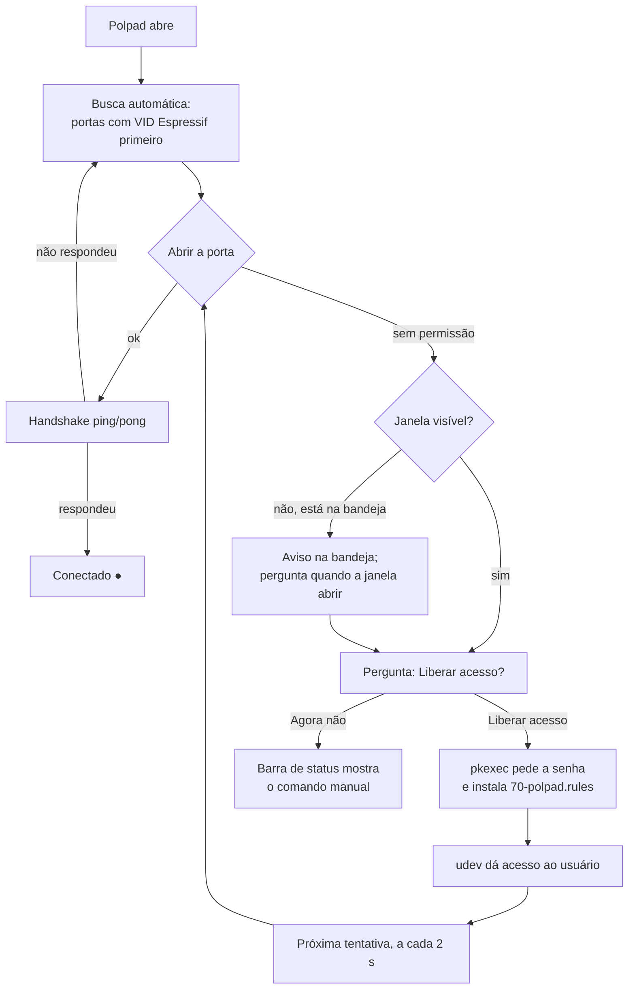

# Relatório — Busca automática no Linux e versões para Linux e Windows

**Data:** 04/11/2026
**Projeto:** Polpad (configurador do macropad ESP32-C3) — versão 0.4.0
**Máquina de teste:** Arch Linux, sessão X11 (XFCE), macropad ligado em `/dev/ttyACM0`

---

## 1. Resumo

| Problema relatado | Situação |
|---|---|
| A porta do macropad não era encontrada automaticamente no Linux | **Resolvido e confirmado na máquina real**: o macropad conectou sozinho pela busca automática |
| A lista de portas tinha "muitas entradas" no Linux | **Resolvido**: 34 itens viraram 2 (`/dev/ttyACM0` e "Busca automática") |
| Precisa existir versão para Linux e Windows | **Workflow pronto**, ainda não executado no GitHub (ver [Pendências](#7-pendências)) |

Nada foi enviado ao GitHub ainda: as mudanças estão só na pasta local, sem commit.

---

## 2. Diagnóstico

### 2.1 O que o log mostrou

O log do aplicativo (`~/.config/Polpad/logs/polpad.log`) mostrou que **a busca automática encontrava o macropad, mas não conseguia abrir a porta**:

```
18:56:20 polpad.device.link WARNING: sem permissão para abrir /dev/ttyACM0: ...
18:57:13 polpad.device.link WARNING: sem permissão para abrir /dev/ttyS4: ...
18:57:23 polpad.device.link WARNING: sem permissão para abrir /dev/ttyS0: ...
18:58:03 polpad.device.link WARNING: sem permissão para abrir /dev/ttyS31: ...
```

- A primeira linha é a busca automática: ela foi direto ao macropad (`/dev/ttyACM0`, fabricante Espressif, VID `0x303A`).
- As seguintes são tentativas manuais, porta por porta, na lista do seletor.

### 2.2 Causas

Eram **dois problemas somados**:

1. **Falta de permissão na porta.** O `/dev/ttyACM0` pertence ao grupo `uucp`, e o usuário não está nele:

   ```
   crw-rw---- 1 root uucp 166, 0 /dev/ttyACM0
   uid=1000(backs) grupos=1000(backs),150(wireshark),998(wheel)
   ```

   Abrir a porta dava `[Errno 13] Permission denied`. O aplicativo só registrava isso no log, e a interface continuava em **"Procurando o macropad…"**, como se o aparelho não estivesse ligado.

2. **Portas fantasmas na lista.** O Linux cria 32 portas `/dev/ttyS0`…`/dev/ttyS31` para conexões seriais que o computador não tem. O pyserial lista todas, sem fabricante e com identificador `n/a`. O macropad ficava escondido no meio delas.

### 2.3 Por que o primeiro teste da correção "não funcionou"

Depois da primeira correção, o problema parecia continuar. O motivo é que **a versão nova nunca chegou a rodar**: o Polpad aberto era o processo antigo, iniciado às 18:55. Como o aplicativo só permite uma instância, abri-lo pelo menu apenas trazia a janela antiga para a frente. O log confirmou isso: às 19:15 ainda havia tentativas em `ttyS4`, `ttyS31`…, portas que a versão nova nem lista mais.

Depois de fechar o processo antigo e abrir o novo, tudo funcionou (ver [seção 5](#5-verificação)).

---

## 3. O que foi feito

### 3.1 Lista de portas só com aparelhos reais

`src/polpad/device/link.py` — `available_ports()` e `_has_hardware()`

- Esconde portas sem aparelho por trás: sem VID USB **e** com identificador `n/a`.
- O macropad (VID da Espressif) aparece primeiro.
- **No Windows nada muda**: lá só aparecem portas que existem, e as que não são USB (como a `COM1` da placa-mãe) trazem um identificador real (`ACPI\PNP0501\1`). Por isso continuam na lista, e há um teste para isso.

### 3.2 Aviso de "sem permissão" chega à interface

- `src/polpad/device/link.py` — o enlace serial ganhou o callback `on_denied`, chamado uma vez por porta quando o sistema recusa o acesso (`EACCES`). A tentativa de conexão foi separada em `_attempt()` para poder ser testada.
- `src/polpad/ui/bridge.py` — novo sinal Qt `port_denied`.
- `src/polpad/app.py` — liga o callback ao sinal.
- A porta recusada **continua sendo tentada a cada 2 s**. Assim que o acesso é liberado, a conexão acontece sozinha, sem reiniciar o aplicativo.

### 3.3 Botão "Liberar acesso" (senha de administrador)

Novo módulo `src/polpad/device/serial_access.py`, sem dependência de Qt.

Ao clicar em **Liberar acesso**, o aplicativo pede a senha de administrador uma vez, pelo `pkexec`, e instala a regra:

```
# /etc/udev/rules.d/70-polpad.rules
SUBSYSTEM=="tty", ATTRS{idVendor}=="303a", TAG+="uaccess", ENV{ID_MM_DEVICE_IGNORE}="1"
```

- **`TAG+="uaccess"`**: o systemd dá ao usuário logado na tela acesso ao aparelho, como já faz com câmera e microfone. Funciona **na hora, sem sair da sessão**. A alternativa clássica (`usermod -aG uucp`) só vale depois de sair e entrar de novo.
- **`ATTRS{idVendor}=="303a"`**: vale só para placas da Espressif. As outras portas do sistema não mudam.
- **`ID_MM_DEVICE_IGNORE`**: impede que o ModemManager ocupe a porta nos primeiros segundos, mandando comandos de modem para ela.
- Instalar a regra e aplicá-la às portas já conectadas acontece num único comando, então a senha é pedida uma vez só.
- A regra passou na validação do próprio sistema (`udevadm verify`).

Na janela principal (`src/polpad/ui/main_window.py`):

- `_on_port_denied()` mostra o aviso no seletor de porta e na barra de status.
- `_offer_port_access()` abre a pergunta com os botões **Liberar acesso** e **Agora não**.
- `_grant_port_access()` chama o `pkexec` numa thread separada, para a janela não travar enquanto a senha é digitada.
- `_on_access_done()` mostra o resultado. Se falhar, mostra o motivo e o comando para resolver à mão.
- Se o app iniciou minimizado na bandeja (inicialização com o sistema), avisa pela bandeja e só pergunta quando a janela for aberta (`showEvent()`). Isso evita uma janela de senha surgindo sozinha no login.
- Escolher uma porta de novo no seletor faz a pergunta voltar, caso a pessoa tenha clicado em "Agora não".

### 3.4 Registros novos no log

- `macropad conectado em /dev/ttyACM0`
- `conexão com o macropad em /dev/ttyACM0 encerrada`
- `liberação de acesso à porta: concluída` (ou o motivo da falha)

### 3.5 Versões para Linux e Windows (GitHub Actions)

**Antes:** o release v0.4.0 tinha só `Polpad.exe` e `firmware-2.0.1.bin`. Quem usa Linux precisava gerar o executável a partir do código.

**Agora:** novo workflow `.github/workflows/executaveis.yml`. O PyInstaller não gera executável para outro sistema, então cada versão é gerada num computador do próprio sistema no GitHub:

| | Windows | Linux |
|---|---|---|
| Runner | `windows-latest` | `ubuntu-22.04` |
| Arquivo no release | `Polpad.exe` | `Polpad-linux-x86_64.tar.gz` |
| Testes | `unittest` | `unittest` dentro do `xvfb-run` (o `pynput` exige uma tela X) |
| Conferência final | abre o `.exe` por 20 s | abre o `Polpad` numa tela virtual por 20 s |

Escolhas importantes:

- **Ubuntu 22.04, e não 24.04**: o executável Linux exige pelo menos a versão da glibc do sistema em que foi gerado. Gerado no 22.04, roda no Ubuntu 22.04+, Debian 12, Fedora e Arch atuais.
- **Bibliotecas gráficas instaladas antes do build** (`libxcb-cursor0` e outras): o PyInstaller embute as que encontra. Sem a `libxcb-cursor0`, o app não abriria num Ubuntu que não a tenha.
- **`.tar.gz` no Linux**: um download direto pelo navegador perderia a permissão de execução.
- **Conferência de versão**: o novo script `tools/conferir_versao.py` recusa uma tag `v0.5.0` se o `pyproject.toml` ou o `src/polpad/__init__.py` ainda disserem outra versão.

Quando o workflow roda:

| Gatilho | O que faz |
|---|---|
| Tag `vX.Y.Z` enviada | testa, gera os dois, confere que abrem e anexa ao release |
| Manual (Actions → Executáveis → Run workflow) | só gera, para baixar em *Artifacts* |
| PR que mexe no empacotamento | só gera, para pegar quebras antes do release |

Se o release da tag não existir, o workflow cria um **rascunho**. Isso é de propósito: o aplicativo baixa o firmware do último release *publicado*, e um release publicado sem o `firmware-*.bin` quebraria a gravação de firmware. O firmware continua sendo anexado à mão.

### 3.6 Testes que quebrariam no Windows

`tests/test_linux.py` — duas classes passaram a rodar só no Linux, como o arquivo já fazia com a inicialização automática:

- `AbrirAlvoNoLinuxTest`: testa o caminho de abertura de programas que só existe fora do Windows, e compara caminhos com `/` contra `\`.
- `PermissaoDaPortaTest`: usa o módulo `grp`, que não existe no Windows.

Sem isso, o build do `.exe` no GitHub falharia já na etapa de testes.

### 3.7 Documentação

`README.md`:

- **Download**: explica os dois arquivos, Windows e Linux.
- **Requisitos**: inclui Linux com X11.
- **Permissão para a porta USB**: descreve o botão **Liberar acesso** e mantém a alternativa manual.
- **Publicar uma versão**: nova seção com o passo a passo da tag até o release.

---

## 4. Como funciona agora

### 4.1 Conexão no Linux



- **Primeira vez em cada computador Linux**: o app pede a senha uma vez.
- **Depois disso**: conecta sozinho, inclusive depois de reiniciar o computador ou de tirar e pôr o cabo, porque a regra fica salva em `/etc`.
- **No Windows**: o fluxo é o mesmo de antes. A pergunta de permissão não existe lá.

### 4.2 Publicar uma versão nova

1. Atualizar a versão em `pyproject.toml` e `src/polpad/__init__.py`.
2. Commit, depois `git tag v0.5.0 && git push origin v0.5.0`.
3. Esperar o workflow **Executáveis** terminar, uns minutos.
4. No rascunho de release criado: escrever as novidades, anexar o `firmware-*.bin` e publicar.

### 4.3 Desfazer a liberação de acesso

```bash
sudo rm /etc/udev/rules.d/70-polpad.rules
sudo udevadm control --reload-rules && sudo udevadm trigger --subsystem-match=tty
```

---

## 5. Verificação

### 5.1 Na máquina real, com o macropad ligado

Log da execução final:

```
19:25:05 polpad.__main__ INFO: Polpad 0.4.0 iniciando
19:25:05 polpad.device.link WARNING: sem permissão para abrir /dev/ttyACM0: ...
19:25:19 polpad.ui.main_window INFO: liberação de acesso à porta: concluída
19:25:26 polpad.device.link INFO: macropad conectado em /dev/ttyACM0
```

Permissão da porta depois da liberação:

```
$ getfacl /dev/ttyACM0
user::rw-
user:backs:rw-      ← acesso dado pela regra
group::rw-
```

Também foi verificado:

- **Seletor de portas**: na janela real, mostra só `/dev/ttyACM0 — USB JTAG/serial debug unit` e "Busca automática".
- **Pergunta de permissão**: aparece com o texto e os botões certos, tanto com a janela aberta quanto iniciando minimizado na bandeja (testado com a janela real em modo offscreen).
- **Executável Linux** (`dist/Polpad`): gerado de novo com as mudanças e copiado para `~/.local/bin/polpad`, que é o atalho do menu.

### 5.2 Testes automáticos

| Verificação | Resultado |
|---|---|
| `python -m unittest discover -t .` | **192 testes, todos passando** (10 novos em `tests/test_portas.py`) |
| `mypy` | sem problemas em 50 arquivos |
| `ruff check .` | 4 avisos, todos já existiam antes destas mudanças |
| `udevadm verify` na regra | válida |
| `tools/conferir_versao.py v0.4.0` / `v0.5.0` | aceita / recusa, como esperado |
| Passo de release do workflow, simulado com um `gh` falso | argumentos e notas corretos |
| `.tar.gz` do Linux | preserva a permissão de execução |

Testes novos (`tests/test_portas.py`):

- `ListaDePortasTest`: portas fantasmas somem, a `COM1` real do Windows fica, e o macropad vem primeiro.
- `PortaSemPermissaoTest`: a interface é avisada uma vez por porta, outros erros não contam como falta de permissão, e a porta recusada continua sendo tentada.
- `LiberarAcessoTest`: a regra cobre o VID 303a com `uaccess`, uma única senha instala e aplica a regra, o arquivo temporário é apagado, e janela de senha fechada e falha são distinguidas.

---

## 6. Arquivos alterados

| Arquivo | Mudança |
|---|---|
| `src/polpad/device/link.py` | filtro de portas, aviso de permissão (`on_denied`), logs de conexão |
| `src/polpad/device/serial_access.py` | **novo** — instala a regra udev via `pkexec` |
| `src/polpad/ui/bridge.py` | sinal `port_denied` |
| `src/polpad/app.py` | liga o aviso de permissão à interface |
| `src/polpad/ui/main_window.py` | pergunta "Liberar acesso", thread do `pkexec`, caso da bandeja, logs |
| `tests/test_portas.py` | **novo** — 10 testes |
| `tests/test_linux.py` | duas classes restritas ao Linux |
| `tools/conferir_versao.py` | **novo** — confere a tag contra a versão do código |
| `.github/workflows/executaveis.yml` | **novo** — gera Windows e Linux e anexa ao release |
| `README.md` | download, requisitos, permissão da porta, como publicar |

Fora do repositório, na máquina de teste:

- `/etc/udev/rules.d/70-polpad.rules`, instalada pelo botão **Liberar acesso**.
- `~/.local/bin/polpad`, atualizado com o build novo.

---

## 7. Pendências

1. **Nada foi commitado nem enviado ao GitHub.** O próximo passo é criar um branch e abrir um PR. Como o PR mexe no workflow, ele mesmo dispara a geração das duas versões.
2. **O workflow ainda não rodou de verdade.** Não havia Docker nem Xvfb na máquina para simular o GitHub Actions. A primeira execução vai confirmar o build e a conferência dos dois executáveis.
3. **Os testes não foram rodados no Windows.** Duas classes que quebrariam lá foram identificadas pela leitura do código e corrigidas, mas pode haver outra falha específica do Windows que só o workflow vai mostrar.
4. **A conexão levou cerca de 6 s depois da liberação**, quando o esperado seria cerca de 2 s (o intervalo entre tentativas). Funciona, mas a causa da diferença não foi investigada.
5. **O executável Linux baixado do release não entra sozinho no menu de aplicativos.** Hoje isso exige o `tools/instalar_linux.py`, que precisa do código-fonte. Uma melhoria possível é o próprio executável oferecer essa instalação.
